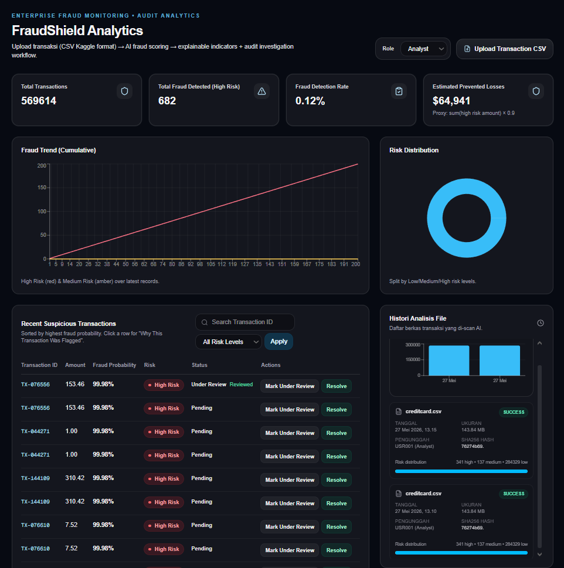

<div align="center">

# 🛡️ FraudShield Analytics

### Enterprise Fraud Monitoring & Audit Analytics Platform

[](https://python.org)
[](https://fastapi.tiangolo.com)
[](https://nextjs.org)
[](https://scikit-learn.org)
[](LICENSE)

**Upload transaction data → AI-powered fraud scoring → Explainable risk indicators → Audit investigation workflow**

</div>

---



---

## 📋 Table of Contents

- [Overview](#-overview)
- [Key Features](#-key-features)
- [Architecture](#-architecture)
- [Tech Stack](#-tech-stack)
- [Project Structure](#-project-structure)
- [Getting Started](#-getting-started)
- [Usage](#-usage)
- [API Reference](#-api-reference)
- [Machine Learning Pipeline](#-machine-learning-pipeline)
- [Audit & Compliance](#-audit--compliance)

---

## 🔍 Overview

**FraudShield Analytics** is an end-to-end fraud detection and audit analytics platform designed for enterprise-grade financial transaction monitoring. The system combines **machine learning-based fraud scoring** with a comprehensive **audit trail and investigation workflow**, aligning with Indonesian financial regulatory standards (POJK No. 11/POJK.03/2022).

The platform enables analysts and auditors to:

- Upload credit card transaction datasets (Kaggle format) for automated fraud scoring
- Visualize risk distributions, fraud trends, and suspicious patterns in real time
- Investigate flagged transactions with explainable AI indicators
- Maintain a complete audit trail of all system activities
- Generate compliance-ready PDF audit reports

---

## ✨ Key Features

### 🤖 AI-Powered Fraud Detection
- **Random Forest Classifier** trained on the Kaggle Credit Card Fraud Detection dataset
- **SMOTE oversampling** to handle extreme class imbalance (fraud < 0.2% of transactions)
- Real-time scoring with fraud probability and risk level classification (Low / Medium / High)

### 📊 Interactive Dashboard
- **KPI Summary Cards** — Total transactions, fraud detected, detection rate, estimated prevented losses
- **Fraud Trend Chart** — Cumulative high-risk and medium-risk transaction trends
- **Risk Distribution** — Donut chart showing Low / Medium / High risk breakdown
- **Transaction Table** — Searchable, filterable list with investigation actions
- **Upload History** — File analysis history with per-upload risk distribution bars

### 🔎 Explainable AI (XAI)
- Each flagged transaction includes human-readable reasons for why it was flagged:
  - Abnormal transaction amount (z-score ≥ 3.0)
  - Unusual timing (midnight–dawn transactions)
  - Burst pattern (rapid-fire transactions within 10 seconds)
  - Statistical deviation from baseline behavior

### 🔐 Audit & Investigation Workflow
- **Role-based access** — Analyst and Auditor roles with scoped actions
- **Investigation statuses** — Pending → Under Review → Resolved
- **Investigator notes** — Auditors can annotate flagged transactions
- **Activity logging** — Every upload, review, and comment is recorded

### 📄 Automated PDF Reporting
- Regulatory-aligned audit reports (POJK-compliant format)
- Executive summary, findings, recommendations, and visual analytics
- Model evaluation plots (confusion matrix, ROC curve)

---

## 🏗 Architecture

```
┌─────────────────────────────────────────────────────────────┐
│                     Next.js Dashboard                       │
│          (React 19 · TypeScript · Tailwind CSS)             │
│     KPI Cards · Charts · Transaction Table · Upload UX      │
└──────────────────────────┬──────────────────────────────────┘
                           │ REST API
┌──────────────────────────▼──────────────────────────────────┐
│                     FastAPI Backend                          │
│              /api/upload · /api/summary · /api/transactions  │
│              /api/activity · /api/uploads                    │
├─────────────────┬───────────────────┬───────────────────────┤
│   ML Engine     │   SQLite (SQLModel)│   Audit Logger       │
│  RandomForest   │   Transactions     │   Activity Logs      │
│  SMOTE · Scaler │   Uploads          │   Compliance Trail   │
└─────────────────┴───────────────────┴───────────────────────┘
                           │
              ┌────────────▼────────────┐
              │   Kaggle Dataset        │
              │   creditcard.csv        │
              │   (284,807 txns)        │
              └─────────────────────────┘
```

---

## 🛠 Tech Stack

| Layer | Technology |
|:------|:-----------|
| **Frontend** | Next.js 16, React 19, TypeScript, Tailwind CSS v4 |
| **Charts** | Recharts |
| **Icons** | Lucide React |
| **Backend** | FastAPI, Uvicorn |
| **Database** | SQLite via SQLModel |
| **ML / Data Science** | scikit-learn, imbalanced-learn (SMOTE), pandas, NumPy |
| **Visualization** | Matplotlib, Seaborn |
| **PDF Reports** | FPDF2 |
| **Deployment** | Netlify (dashboard) |

---

## 📁 Project Structure

```
fraud-audit-system/
│
├── backend/                    # FastAPI REST API
│   └── app/
│       ├── main.py             # API endpoints (upload, summary, transactions, activity)
│       ├── ml.py               # ML scoring engine (RandomForest + explainability)
│       ├── models.py           # SQLModel schemas (TransactionRecord, ActivityLog, etc.)
│       ├── db.py               # Database initialization & session management
│       └── audit.py            # Activity logging utility
│
├── dashboard/                  # Next.js frontend application
│   └── src/
│       ├── app/
│       │   ├── page.tsx        # Main dashboard page (KPIs, charts, tables)
│       │   ├── layout.tsx      # Root layout with metadata
│       │   └── globals.css     # Global styles
│       └── components/
│           └── RiskBadge.tsx    # Risk level badge component
│
├── src/                        # Standalone ML pipeline & audit scripts
│   ├── preprocessing.py        # Data loading & feature scaling
│   ├── train_model.py          # Model training with SMOTE + evaluation
│   ├── export_predictions.py   # Batch prediction export to CSV
│   ├── simulate_logs.py        # Synthetic audit log generator
│   ├── log_analyzer.py         # Audit log analysis & visualization
│   ├── audit_logger.py         # SQLite-based audit trail manager
│   └── generate_report.py      # PDF audit report generator (POJK-aligned)
│
├── data/                       # Dataset directory (gitignored)
│   └── creditcard.csv          # Kaggle Credit Card Fraud Detection dataset
│
├── logs/                       # Audit trail database (gitignored)
├── reports/                    # Generated reports & plots
├── notebooks/                  # Jupyter notebooks for exploration
│
├── requirements.txt            # Python dependencies
├── netlify.toml                # Netlify deployment configuration
└── dashboard.png               # Dashboard screenshot
```

---

## 🚀 Getting Started

### Prerequisites

- **Python** 3.10+
- **Node.js** 18+
- **Kaggle Dataset** — [Credit Card Fraud Detection](https://www.kaggle.com/datasets/mlg-ulb/creditcardfraud) (`creditcard.csv`)

### 1. Clone the Repository

```bash
git clone https://github.com/hasfi-therasyan/Credit-Card-Fraud-Detection-Dashboard.git
cd Credit-Card-Fraud-Detection-Dashboard
```

### 2. Set Up the Python Environment

```bash
python -m venv venv
venv\Scripts\activate        # Windows
# source venv/bin/activate   # macOS/Linux

pip install -r requirements.txt
```

### 3. Place the Dataset

Download `creditcard.csv` from [Kaggle](https://www.kaggle.com/datasets/mlg-ulb/creditcardfraud) and place it in the `data/` directory:

```
data/creditcard.csv
```

### 4. Train the ML Model (Optional)

```bash
cd src
python train_model.py
```

This trains a Random Forest with SMOTE and saves the model to `src/fraud_model.pkl` along with evaluation plots in `reports/`.

### 5. Start the Backend API

```bash
# From the project root
uvicorn backend.app.main:app --reload --port 8000
```

> **Note:** On first upload, the backend auto-trains a model from the dataset if no pre-trained model is found.

### 6. Start the Dashboard

```bash
cd dashboard
npm install
npm run dev
```

Open [http://localhost:3000](http://localhost:3000) in your browser.

---

## 📖 Usage

1. **Select your role** — Choose between `Analyst` or `Auditor` from the role dropdown
2. **Upload transactions** — Click "Upload Transaction CSV" and select a Kaggle-format CSV file
3. **Review dashboard** — KPI cards, fraud trend, and risk distribution update in real time
4. **Investigate transactions** — Browse the suspicious transactions table, sorted by fraud probability
5. **Take action** — Mark transactions as "Under Review" or "Resolved", and add investigator notes
6. **View upload history** — Check the file analysis history panel for past scans and risk breakdowns

---

## 📡 API Reference

| Method | Endpoint | Description |
|:-------|:---------|:------------|
| `GET` | `/api/health` | Health check |
| `POST` | `/api/upload` | Upload and score a transaction CSV |
| `GET` | `/api/summary` | Fraud detection summary statistics |
| `GET` | `/api/transactions` | List transactions (with search, filter, pagination) |
| `POST` | `/api/transactions/{id}/review` | Update investigation status |
| `POST` | `/api/transactions/{id}/note` | Add investigator notes |
| `GET` | `/api/uploads` | List upload history |
| `GET` | `/api/activity` | Audit activity log |

---

## 🧠 Machine Learning Pipeline

### Dataset

- **Source:** [Kaggle Credit Card Fraud Detection](https://www.kaggle.com/datasets/mlg-ulb/creditcardfraud)
- **Size:** 284,807 transactions, 492 fraudulent (0.172%)
- **Features:** V1–V28 (PCA-transformed), Time, Amount

### Pipeline Steps

```
Raw CSV → StandardScaler (Amount, Time) → SMOTE Oversampling → Random Forest → Evaluation
```

1. **Preprocessing** — Scale `Amount` and `Time` columns (V1–V28 are pre-scaled via PCA)
2. **Class Balancing** — SMOTE oversampling to address extreme class imbalance
3. **Training** — Random Forest Classifier (100 estimators, max depth 10)
4. **Evaluation** — Classification report, confusion matrix, ROC-AUC score
5. **Scoring** — Real-time prediction with probability-based risk levels:
   - 🟢 **Low Risk:** probability < 0.4
   - 🟡 **Medium Risk:** 0.4 ≤ probability < 0.8
   - 🔴 **High Risk:** probability ≥ 0.8

---

## 🔒 Audit & Compliance

The system is designed with Indonesian financial regulations in mind:

- **POJK No. 11/POJK.03/2022** — Information technology governance for commercial banks
- **COBIT 2019** — Segregation of Duties (SoD) and access control frameworks

### Audit Features

- Complete access log with timestamp, user, role, action, resource, and status
- Off-hours access detection (outside 08:00–17:00)
- High-risk action monitoring (DELETE, MODIFY operations)
- Failed access attempt tracking (brute-force indicators)
- Automated PDF audit reports with executive summary, findings, and recommendations

---

<div align="center">

**Built with ❤️ for financial security and regulatory compliance**

</div>
